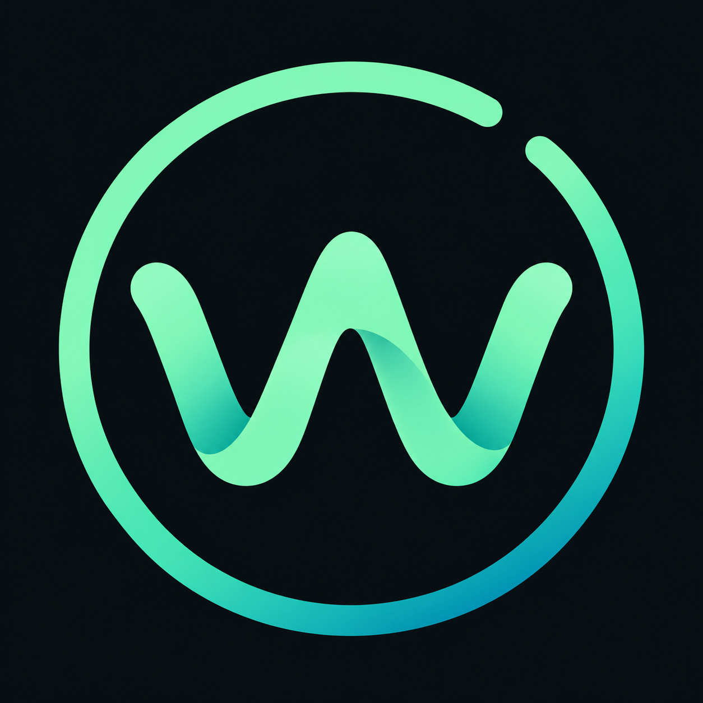
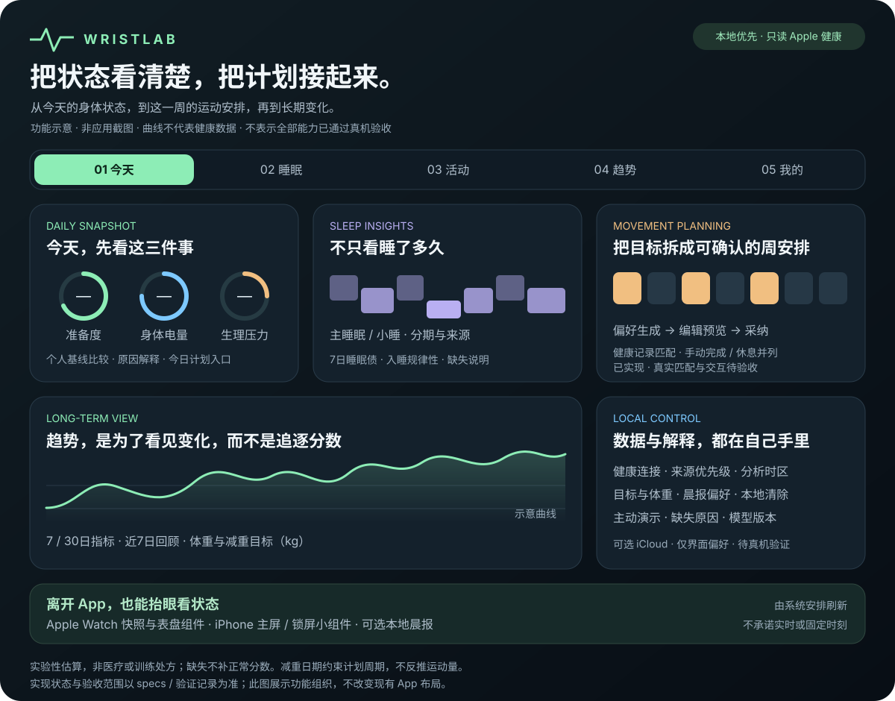
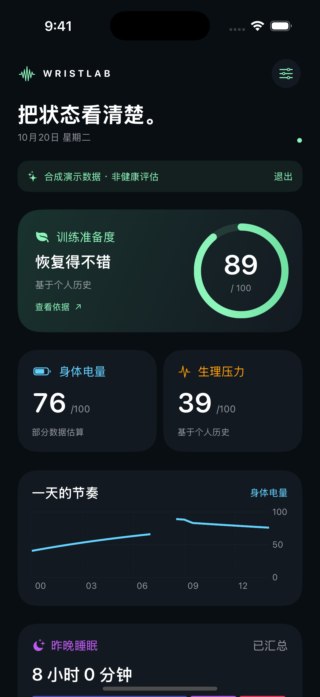
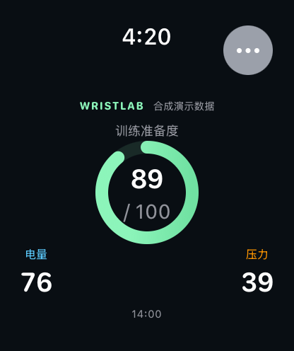

<div align="center">

# Wristlab



**把状态看清楚。**

一个本地优先的 iPhone + Apple Watch 私人健康趋势实验室。

[English](README.en.md) · [业务规格](specs/README.md) · [开发指南](docs/development.md) · [验证记录](docs/validation.md)


</div>

## 功能 Dashboard



**看状态 → 选安排 → 记执行 → 看变化。** 五个页签组织日常体验，健康数据留在设备上；界面偏好可选iCloud同步，需具备有效云能力签名。

> 上图为功能示意面板，不是 App 截图；曲线、圆环和日历块均为说明性图形，不代表健康数据或当前分数。自动计划、减重目标已实现并装入手机，真实记录匹配与页面交互仍待验收；不表示全部功能已发布或通过真机验证。

| 我想… | 去哪里 | 目前能做什么 |
| --- | --- | --- |
| 快速知道今天状态 | **今天** | 准备度、电量、压力；查看原因与个人基线；进入今日安排 |
| 看昨晚睡得如何 | **睡眠** | 主睡眠、小睡、阶段、7日睡眠债和规律性 |
| 安排这一周并看运动达标 | **活动** | 自动生成周草案，编辑后采纳；按有效健康记录匹配时长；手动完成、休息和替换；已观测负荷及心率区间 |
| 设置减重方向、回顾变化 | **趋势** | 健康 / 运动 / 体重页内分区；独立7/30日图表、运动周回顾、kg体重目标与周均；日内节奏进入详情 |
| 管理目标和数据 | **我的** | 健康连接、计划/目标入口；进入来源、时区、通知与清除设置 |

减重目标用于记录方向与周期，**不根据“减几公斤 / 剩几天”直接换算运动量**；自动草案需要确认，健康记录缺失时不虚构达标。

[展示优化方案：信息层级、各页分工与实施顺序](docs/display-optimization.md) · [业务规格](specs/README.md) · [验证边界](docs/validation.md)

## 原生界面截图

Watch日常关怀版已实现，代码/模拟器阶段Gate 3已确认，新版真机仍待验：**关怀 / 活动 / 状态**三页，图标加短标签替代直接评分；主动连接后看系统步数、锻炼分钟和圆环，压力趋势只使用所选本地报告。可选心情只留本机当天、不参与评分或同步，今日活动组件不显示心情。缺失不补零、没闭环不催补；不新增通知或运动录制。[本轮验收与待验项](.stdd/archive/2026-10-23-watch-daily-care/test-report.md)。下列已入库Watch截图是此前版本，不代表本轮新布局。

<table align="center">
<tr><th>iPhone · 今日报告</th><th>Apple Watch · 抬腕查看</th></tr>
<tr>
<td valign="top"></td>
<td valign="top"></td>
</tr>
</table>

截图由 CI 在实际运行的 SwiftUI 应用中通过 `--demo` 生成，使用合成健康记录，与真实模式共用业务引擎。不是概念图，也不包含真实健康数据。设备与生成来源见 [截图说明](docs/screenshots/README.md)。

## 能做什么

| 功能 | 业务行为 |
| --- | --- |
| 训练准备度 | 60日个人历史、至少14个有效日；夜间优先，必要时明确回退日间估算 |
| 生理压力 | 5分钟桶，睡眠/清醒基线隔离；HRV缺失时标注仅依据心率 |
| 身体电量 | 睡眠充电、活动耗电、跨日连续；缺口和重新校准明确可见 |
| 睡眠 | 单来源解析、分期去重、主睡眠/小睡、7日睡眠债与入睡规律性 |
| 运动 | 只读已有训练，HRR心率分区、已观测负荷、体能输出与历史参考区间 |
| 运动计划 | 按经验、偏好、可用星期和时长上限生成可编辑周草案；采纳后生效；健康运动完成度与人工完成/休息独立，周反馈调整需再次确认 |
| 体重与减重目标 | 仅 kg 手动记录、目标体重与日期、周均趋势、到期回顾；不承诺减脂速度或以期限强制加练 |
| 数据解释 | 与个人基线比较（推高/拉低及差值）、规格分段短句、缺失原因、基线数量、部分质量、覆盖度、版本和更新时间 |
| 双端体验 | 手机报告、一天的节奏（电量+压力，标出睡眠/运动）、睡眠详情、7/30日趋势（准备度/睡眠/负荷/夜间HRV/静息心率，含个人基线区间）与近7日回顾；手表快照；电量/准备度/压力及总览表盘组件 |
| iPhone小组件 | 主屏小/中与锁屏圆形/矩形/行内显示最近一次准备度、电量与压力；过期、等待、清除与真实0沿用表盘组件规则，演示不写入 |
| 晨报通知 | 设置中开启后，今天主睡眠完成、5:00–14:00内的首次刷新推送一条本地晨报（默认隐藏数值）；每天一次，送达时间不固定 |
| 心情记录 | iOS 18+主动连接后只读自报心情，与同时段生理压力并列；不推算心情、不判断因果，不同步Watch |
| 本地控制 | 选源、固定分析时区、目标设置、清缓存/停止读取、离线清除标记 |

Watch独立使用已实现，尚待新版真机验收：在“更多 → 手表独立设置与连接”确认本地设置并主动连接健康；支持手表本地/手机同步显式选择、前台和手动刷新。历史不足保留校准原因，不自动混合两份报告，不承诺后台定时更新。

真实模式默认空状态，用户主动连接 Apple 健康后读取。演示需要主动进入，始终标识合成数据，不写入真实同步缓存。

## 运行

需要安装完整 **Xcode**（只支持最新版，CI 使用 Xcode 27），并安装iOS/watchOS平台组件；还需[XcodeGen](https://github.com/yonaskolb/XcodeGen)。

```sh
git clone https://github.com/mirsery/wristlab.git
cd wristlab
brew install xcodegen
./scripts/check.sh
./scripts/build-apple.sh
open Wristlab.xcodeproj
```

在Xcode为iPhone、Watch、表盘组件及iPhone小组件四个target选择自己的签名team。真机需配对设备、开发者模式，以及支持HealthKit、App Groups和相关entitlements的签名配置。修改bundle ID时同步修改Watch companion ID及App Group标识；详见[真机指南](docs/development.md)。

模拟器想直接看演示，可在scheme的启动参数加入 `--demo`。普通启动不会自动创建健康分数。

## 数据与算法

健康记录在设备本地处理和存储，采用文件保护与原子提交。没有自建后端、广告/统计SDK、独立注册账号、订阅或AI上传。双端间只发送最小展示快照，不传原始心率序列；Watch主动连接健康后，独立在自身私有仓库保存本机可读取记录，与手机副本分区。

“我的 → iCloud与数据中心”已实现默认关闭的界面偏好同步：仅趋势主题、健康指标选择及健康/运动各自7/30日筛选。首次恢复或冲突需确认，不上传健康、体重、目标或计划。当前Personal Team不支持iCloud，尚未安装含云能力的新版本、未通过真实云读写或换机验收；[配置要求](docs/development.md#icloud界面偏好同步)与[验证报告](.stdd/changes/2026-10-22-icloud-data-center/test-report.md)。

当前默认构建也不启用iCloud签名权限，云同步源码保留；未来需显式使用`project-icloud.yml`和支持CloudKit的团队。手机与Watch的本地同步不依赖iCloud。

准备度、压力和电量是公开版本化的**实验性估算**，不是直接测量，不用于医疗判断或训练处方。本项目以PeakWatch公开业务行为为参考，使用原创名称、界面和代码；与PeakWatch无关联，未使用其私有算法，也不保证分数相同。HRV v1使用**SDNN**，不会称为RMSSD。[参考证据和差异](specs/000-reference-behavior.md)

保守的数据门槛会使部分指标暂时为空：没有主睡眠不初始化电量；连续缺口超过30分钟会断链；日负荷覆盖不足不生成完整日参考目标。这些都不会被演示值或默认正常分数替代。

## 架构与验证

```text
HealthKit增量 → 规范记录/来源 → 睡眠与个人基线
                              → 准备度/压力/负荷 → 电量重放
                              → 原子本地报告 → 手机 / Watch / 组件
```

- `Packages/WristlabCore`：纯Swift领域计算、报告、事务存储与同步协议。
- `Apps/iOS`：设置、报告、图表、解释和iOS专属心情读取。
- `Apps/SharedHealth`：双端只读HealthKit分页、转换与取消适配。
- `Apps/WatchSupport`：可注入读取器的独立报告/来源/持久化协调器。
- `Apps/watchOS`：独立设置/授权、来源切换、手机快照、新手机确认与演示。
- `Apps/Widgets`：WidgetKit三指标与总览表盘组件。
- `Apps/PhoneWidgets`：iPhone主屏/锁屏小组件。
- `project.yml`：工程源配置；生成的Xcode工程不提交。

CI验证规格结构、领域测试及双端模拟器构建，并生成截图。12组数值金例来自spec；更多边界和端到端用例见[验证记录](docs/validation.md)。**模拟器构建与截图不等于真机HealthKit、后台调度、签名或组件安装通过。**

尚未包含AI、饮食识别、训练课程、运动录制、云同步、商业化及上架流程。完整范围以[业务spec](specs/README.md)为准。

## 参与

先更新spec和验收，再实现/测试，使用PR合并。`main`要求两项CI检查通过，禁止强推和删除。[AGENTS.md](AGENTS.md) · [CONTRIBUTING.md](CONTRIBUTING.md) · [PRIVACY.md](PRIVACY.md)

MIT License。Issue、日志、测试和截图只提交合成数据，勿上传健康导出或签名资料。

开发流程采用 [STDD](docs/stdd.md)：Spec + Test 驱动、四阶段与三道确认 Gate。项目初始化命令入口为 `./scripts/stdd`。

## Apple Watch 表盘

手机“设置 → Apple Watch → 表盘组件”及手表“更多 → 表盘组件”中有添加步骤和明确标注的合成预览。单项电量、准备度、压力支持圆形、矩形、行内与角落槽位；状态总览使用矩形槽位。具体可用项由系统表盘决定。

真实组件只显示手机同步快照，缺失/校准/过期不补默认分数，过期值显示破折号。点击单项打开对应报告；总览打开Watch首页，外部组件入口退出演示。系统决定刷新预算，不承诺实时刷新。尚无打包好的.watchface预设文件，使用系统表盘编辑器添加。

本轮已通过本机编译和纯逻辑测试；实际表盘安装/冷热点击及系统刷新以[验证记录](docs/validation.md)为准，不以应用内示意预览代替验收。

[本轮表盘说明页实际截图](docs/screenshots/watch-face/README.md)（合成预览，非系统表盘截图）。
