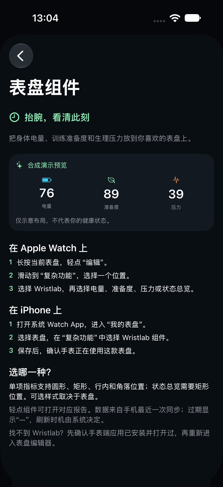
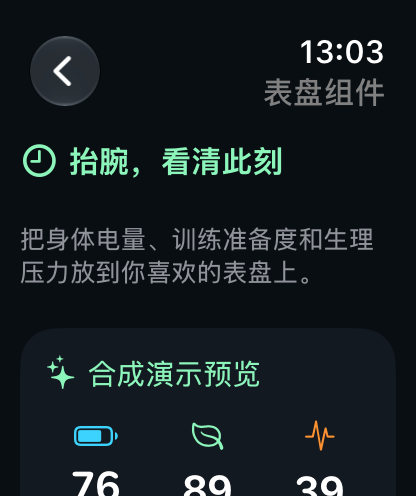

# 本地安装说明页观察

2026-10-21，Xcode27.1，iPhone18Pro/iOS27.1与WatchSeries12/watchOS27模拟器。截图仅包含明确标注的合成演示预览，不是系统表盘或真实健康数据。

iPhone通过设置页正常导航打开；Watch通过开发参数--face-guide打开，Watch更多菜单入口仍待手动验证。实际表盘组件枚举、安装、点击冷/热启动、各family及低亮度外观未由这些图片证明。原图SHA256见manifest.json。

